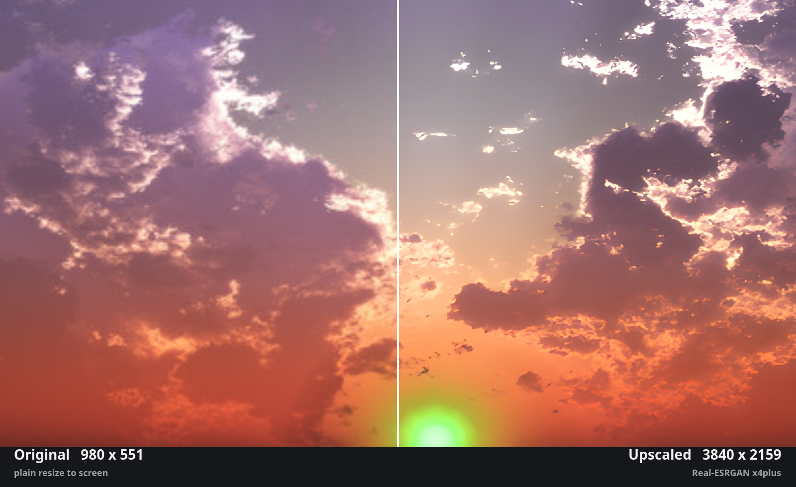
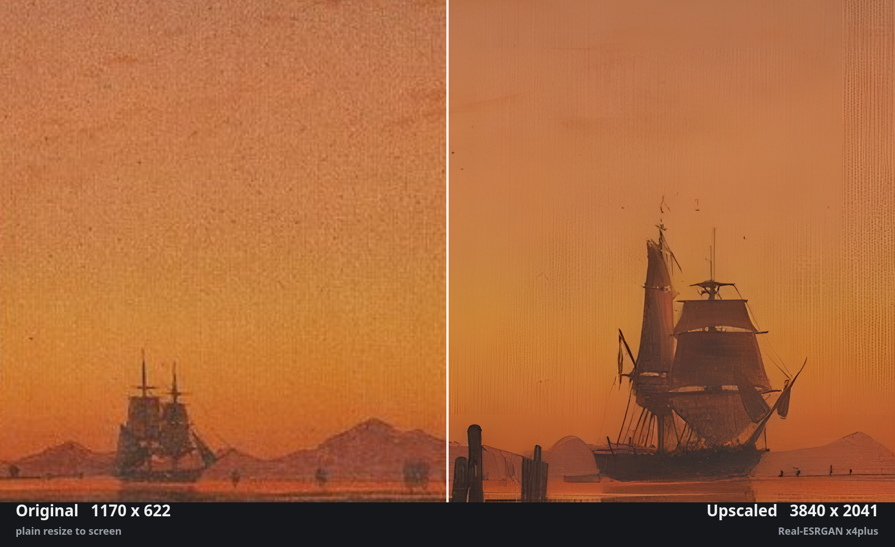
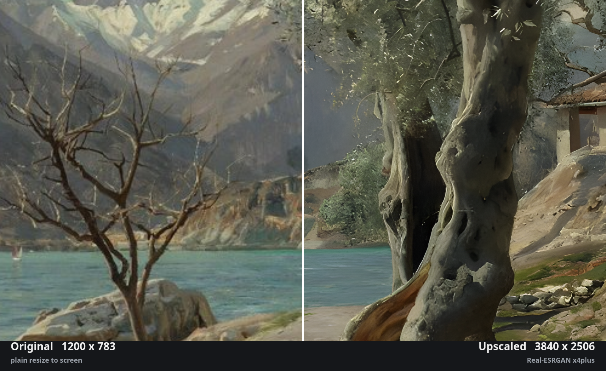

# Upscale Walls

Upscales a small wallpaper on the GPU when you pick it, then applies the larger copy. The original file is never modified.

## Before and after

Each image is one 4K screen view split down the middle into two halves. The left half is the original drawn by a plain resize. The right half is the plugin's output. Each half shows its resolution underneath, and that number is the file's real size.

Real-ESRGAN also adds faint vertical streaks on smooth skies, visible at the right edge of the ship image. It smooths canvas grain too. Switch to waifu2x for painted work like that.

## What it does

1. Every 2.5 seconds the service runs `bin/upscale_walls.py tick`.
2. The worker reads the current wallpaper from `~/.local/state/ryoku/stage-walls.json`.
3. A still image narrower than the target width (default 3840 px) goes through an upscaler. Anything else is skipped.
4. The result lands in the plugin cache and is applied with `ryogami wallpaper set`.
5. The same file with the same settings is served from the cache in about 0.1 s.

The bar glyph appears only on demand. While an upscale runs it shows the percentage and a thin progress strip. It then stays for a set time after the result so you can still see it. Hover it for a details card with the file, engine, size, elapsed time and time remaining. Click it to pin the card. Place it next to the clock with `ryoku-shell bar move upscale-walls --section center`. A desktop notification marks the start and the end. The panel shows the last result, with **Show original** and **Upscale again** buttons.

If you pick another wallpaper while one is processing, the finished copy is cached and marked ready but not applied, so it never replaces your newer pick.

## Upscalers

| Setting | Engine | Use it for |
|---|---|---|
| Auto | Real-ESRGAN when installed, else waifu2x | Default |
| waifu2x | `waifu2x-ncnn-vulkan`, cunet model | Painted art, grain you want to keep |
| Real-ESRGAN | `realesrgan-ncnn-vulkan`, x4plus model | Blocky or noisy JPEGs |

Measured on an RTX 3050 Laptop (4 GB): about 1 GB VRAM per job, about 3 s per input megapixel at 2x. One job runs at a time. The engine picks the fastest Vulkan device on its own, which is the NVIDIA card here. Set a GPU index in settings to override.

## Install the engines

This plugin ships no binaries (rule R10).

- waifu2x: `sudo pacman -S waifu2x-ncnn-vulkan`
- Real-ESRGAN: not in the official repos. Build `realesrgan-ncnn-vulkan-git` from the AUR, then place the binary on `PATH` or in `~/.local/bin`. Place its `realesrgan-x4plus.param` and `.bin` files in `~/.local/share/realesrgan-ncnn-vulkan/models/`. The AUR PKGBUILD needed a CMake patch for the current glslang layout.

Without Real-ESRGAN the plugin falls back to waifu2x.

## What runs, reads, writes

| | |
|---|---|
| Runs | `python3`, `magick` (read image size, resize), `waifu2x-ncnn-vulkan`, `realesrgan-ncnn-vulkan`, `notify-send`, `ryogami wallpaper set <path>` |
| Reads | `~/.local/state/ryoku/stage-walls.json`, the wallpaper image |
| Writes | `$XDG_STATE_HOME/ryoku/plugins/upscale-walls/` (status, handled marker, lock), `$XDG_CACHE_HOME/ryoku/plugins/upscale-walls/` (upscaled PNGs, pruned to the cache limit) |
| Network | None |
| Privileged | None |

Every external call uses an argv list, with no shell string.

## Limits

- The original shows for a few seconds before the upscaled copy replaces it.
- After **Show original**, picking the same file again is invisible to the plugin because Ryogami does not rewrite its state. Use **Upscale again**, or pick a different wallpaper first.
- Animated, video and Wallpaper Engine wallpapers are skipped.
- Real-ESRGAN smooths painted brushwork and canvas grain. Switch to waifu2x for those.

## Settings

Under QS Bar Settings > Community: enable, upscaler, skip width, glyph linger time, cache limit, GPU index.
